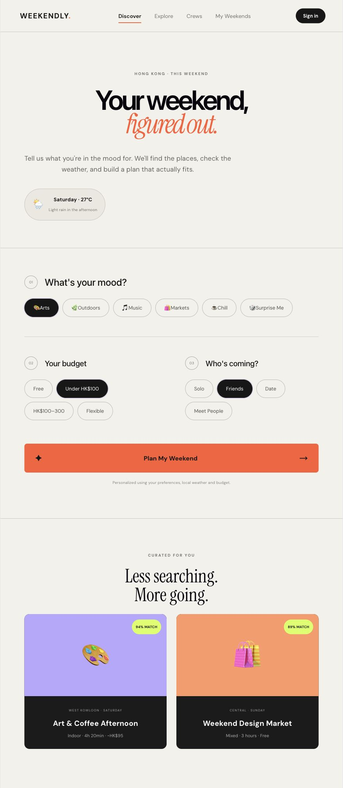
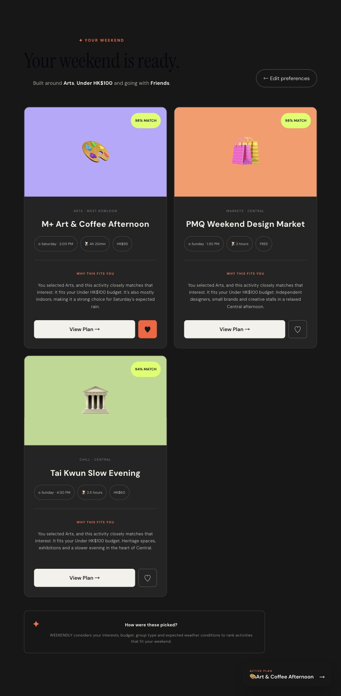
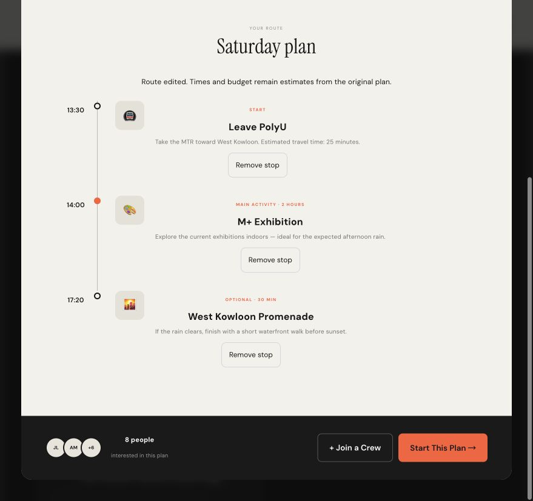

# WEEKENDLY

An interactive weekend-planning prototype for students and young adults in Hong Kong.

**Live demo:** https://weekendly-taupe.vercel.app  
**Public repository:** https://github.com/Cshushs1/weekendly

## Design Idea

Planning a weekend can involve comparing activities, budgets, locations and other people's preferences. WEEKENDLY brings these decisions into a small interactive experience.

The project explores how a website can help users move from “What should I do?” to a plan they can review, adjust and save.

## Target Users

Students and young adults in Hong Kong who want to discover activities and organize a weekend alone, with friends or on a date.

## Main Interaction Loop

**Input → Response → Feedback → Next action**

1. Users select an interest, budget and companion type.
2. The application ranks sample activities using these preferences.
3. Recommendation cards display matching information, estimated costs and activity details.
4. Users open a plan, remove unwanted stops, bookmark an activity or start the plan.
5. My Weekends displays saved activities and the active plan.
6. Users can check in, add a rating and write a short memory.

Selecting Surprise Me instead randomly opens a sample activity within the selected budget. When multiple eligible activities are available, the immediately previous random result is avoided.

## Features

### Activity Recommendations

Sample activities are ranked using local rules based on interests, budget and companion type.

Match percentages are illustrative scores, not predictions from a trained AI model.

### Editable Itineraries

Users can remove individual stops before starting a plan. At least one stop must remain.

An edited plan displays a notice explaining that the original estimated times and costs have not been recalculated.

### Saved Plans and Weekend Memories

Users can bookmark activities, start a plan and add a rating and short note after an outing.

Saved activity IDs, the active plan and the latest weekend memory are stored using browser localStorage.

### Demo Profile

The navigation includes a demo sign-in flow. Users enter a display name, see their initials and can sign out.

This is not an authenticated account system. No password is requested or collected.

### Real Map

An embedded OpenStreetMap map allows users to pan and zoom around Hong Kong and open a larger map.

It does not display personal activity markers, visited locations or calculated travel routes.

## Screenshots

### Discover and Preferences

### Recommendations

### Itinerary Editing

## How to Run

### Requirements

- Node.js and npm
- A modern web browser
- Internet access for the embedded map and externally hosted fonts

### Development

Clone the repository:

    git clone https://github.com/Cshushs1/weekendly.git

Enter the project folder:

    cd weekendly

Install the dependencies recorded in package-lock.json:

    npm ci

Start the development server:

    npm run dev

Open the local URL printed in the terminal.

### Production Build

Build the project:

    npm run build

Preview the production build:

    npm run preview

Open the preview URL printed in the terminal.

The online demo is hosted on Vercel. No API key is required to run the current prototype.

## Suggested Test Flow

1. Select Arts, Under HK$100 and Friends.
2. Click Plan My Weekend and review the recommendations.
3. Open a plan and remove one itinerary stop.
4. Start the edited plan and find it in My Weekends.
5. Save an activity, refresh the page and check that it remains saved.
6. Select Surprise Me and generate a random plan.
7. Open Sign in, enter a display name and sign out.
8. Open the map and try panning and zooming.

User-testing observations and design decisions belong in PROCESS.md. This suggested flow is not evidence that a user test has been completed.

## Error Handling and Recovery

- Blank or whitespace-only demo display names are rejected.
- Corrupted JSON in browser storage falls back to initial values.
- Storage failures display a notice instead of silently claiming that changes were saved.
- The final itinerary stop cannot be removed.
- Dialogs provide close controls; the demo-profile dialog also supports Escape.
- Users can return to Discover through the main navigation.

The embedded map and external fonts depend on third-party services. The map includes a link to open OpenStreetMap separately, but there is no custom offline map fallback.

## Known Limitations

- Activity listings, prices, schedules, group information and weather are sample data, not live verified information.
- Recommendation scores are calculated locally. No AI model or live weather service is connected.
- Standard recommendations rank activities rather than strictly excluding every over-budget option. Surprise Me applies a budget filter.
- Removing itinerary stops does not recalculate travel times, duration or costs.
- Explore category buttons are currently visual controls without filtering behavior.
- Crew creation and guide sharing are prototype interactions, not functioning multi-user services.
- Crew membership uses a simplified shared state rather than separate membership records for every crew.
- Only one active plan and the latest check-in memory are retained.
- Demo profiles do not provide authentication or data separation.
- Stored plans are shared between demo profiles in the same browser and website origin.
- Data does not synchronize across devices. Clearing browser storage removes locally stored information.
- The map does not generate navigation routes or show personal activity history.

## Technology and Dependencies

- React and React DOM
- Vite and the React Vite plugin
- JavaScript and JSX
- CSS
- Browser localStorage
- OpenStreetMap embed
- Vercel deployment

Exact dependency versions are recorded in package-lock.json. Project commands and declared dependencies are listed in package.json.

## Project Structure

    weekendly/
    ├── public/             Static assets
    ├── src/
    │   ├── assets/         Project assets
    │   ├── App.jsx         Interface, activity data and interactions
    │   ├── App.css         Application styles
    │   ├── index.css       Global styles
    │   └── main.jsx        React entry point
    ├── index.html
    ├── package.json
    ├── package-lock.json
    ├── vite.config.js
    └── README.md

## Credits and Sources

- The project uses the React and Vite development ecosystem.
- The repository began with a React + Vite starter.
- Map data and the embedded map are provided by [OpenStreetMap contributors](https://www.openstreetmap.org/copyright).
- DM Sans and Instrument Serif are loaded through [Google Fonts](https://fonts.google.com/).
- Emoji appearance is provided by the user's operating system and browser.
- Activity descriptions, prices, schedules and weather are illustrative prototype content, not an official event feed.

## AI Assistance

OpenAI Codex was used to discuss interaction ideas, generate and revise code, identify issues and draft documentation.

An adopted suggestion was to persist saved activities and plans using browser storage.

A proposed real authentication system was changed to an explicitly labelled demo-profile flow to keep the classroom project manageable. The final prototype does not use Supabase or real account authentication.

Further development decisions and actual user-testing observations should be recorded in PROCESS.md.

## Future Development

- Make all visible category filters functional.
- Apply strict budget filtering to standard recommendations.
- Add itinerary reordering and time and cost recalculation.
- Add activity markers to the real map.
- Preserve multiple completed weekend memories.
- Connect verified activity information and weather data.
- Introduce real accounts, shared plans and crew participation.

## Author

GitHub: [Cshushs1](https://github.com/Cshushs1)

A course project exploring user input, meaningful program responses and clear interaction feedback.
